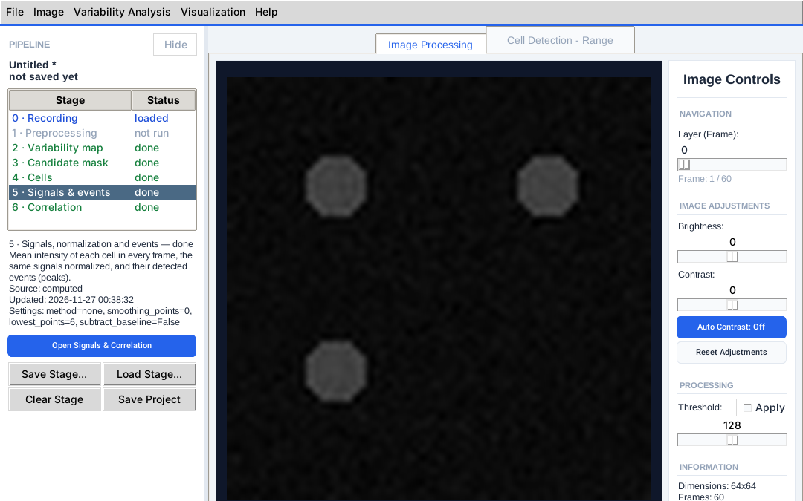

# Manual de Usuario — NecLab

Manual de usuario completo de NecLab, la herramienta de análisis de imágenes de microscopía y visualización de datos del laboratorio LansBiodyt, Facultad de Ciencias, UNAM.

Para instrucciones de instalación vea el [README](../README.md). Este manual asume que ya tiene la aplicación instalada y corriendo (`python interface3.py` o el ejecutable precompilado).

> 🇬🇧 English version: [USER_MANUAL.md](USER_MANUAL.md)

---

## Tabla de contenidos

1. [Visión general de la aplicación](#1-visión-general-de-la-aplicación)
2. [Barra de menús](#2-barra-de-menús)
3. [Pestaña: Image Processing (Procesamiento de Imágenes)](#3-pestaña-image-processing-procesamiento-de-imágenes)
4. [Análisis de Variabilidad y detección de células](#4-análisis-de-variabilidad-y-detección-de-células)
5. [Pestaña: Data Visualization (Visualización de Datos)](#5-pestaña-data-visualization-visualización-de-datos)
6. [Pestaña: Multiple Files (Datos Múltiples)](#6-pestaña-multiple-files-datos-múltiples)
7. [Pestaña: Dendrogram (Dendograma)](#7-pestaña-dendrogram-dendograma)
8. [Pestaña: Time Series (Series de Tiempo)](#8-pestaña-time-series-series-de-tiempo)
9. [Cargar una matriz de correlación precalculada](#9-cargar-una-matriz-de-correlación-precalculada)
10. [Atajos de teclado](#10-atajos-de-teclado)
11. [Actualizaciones automáticas](#11-actualizaciones-automáticas)
12. [Glosario de métodos](#12-glosario-de-métodos)
13. [Solución de problemas](#13-solución-de-problemas)

---

## 1. Visión general de la aplicación

NecLab tiene dos flujos de trabajo principales, organizados en pestañas dentro de una sola ventana:

- **Procesamiento de imágenes**: cargar una pila OME-TIFF, ajustar su visualización y analizar la variabilidad temporal de cada píxel para detectar y segmentar células como clusters espaciales.
- **Visualización y análisis de datos**: cargar series numéricas (un archivo `.npy`/`.csv`, o varios archivos Excel a la vez) para detectar picos, suavizar señales, normalizar, calcular correlaciones y construir dendrogramas.

Ambos flujos comparten la misma ventana principal, que tiene una barra de menús arriba y un cuaderno de pestañas (`Notebook`) debajo. La pestaña Image Processing está desde el inicio; todas las demás vistas se abren como otra pestaña de la misma ventana, nunca como una ventana aparte: Cell Detection (Detección de Células), Signals & Correlation (Señales y Correlación), 3D View (Vista 3D), Correlation Matrix (Matriz de Correlación), Histogram, Binarization, Multiple Files, Dendrogram y Time Series. Una pestaña abierta así tiene una barra delgada arriba con sus propios menús (si los tiene) a la izquierda y un botón **✕ Close Tab** (Cerrar Pestaña) a la derecha. **Nota:** la interfaz de la aplicación está completamente en inglés; este manual describe cada etiqueta en inglés y su traducción al español entre paréntesis para que pueda seguirlo sin problema.

---

## 2. Barra de menús

### File (Archivo)

| Opción | Acción |
|---|---|
| **New Project** / **Open Project...** / **Save Project** (`Ctrl+S`) / **Save Project As...** (Nuevo / Abrir / Guardar / Guardar Proyecto Como) | Empieza, abre o guarda un proyecto: todo el análisis de una grabación, cada etapa con sus parámetros, guardado en una carpeta `.neclab`. Ver [sección 4.9](#49-proyectos). |
| **Show Pipeline Sidebar** (Mostrar Barra Lateral del Pipeline) | Muestra u oculta la barra lateral del pipeline a la izquierda: el estado de cada etapa (not run, done, loaded, out of date, missing), sus detalles, un botón para abrirla o ejecutarla, y guardar o cargar una sola etapa. Ver [sección 4.10](#410-la-barra-lateral-del-pipeline). |
| **Open Recording (OME-TIFF / TIFF / NPY)...** (Abrir Grabación, `Ctrl+O`) | Carga una grabación (una pila de imágenes de frames × alto × ancho) desde un OME-TIFF, un TIFF normal o un archivo NumPy `.npy`, cambia a la pestaña "Image Processing" y habilita los menús Image y Variability Analysis. Los archivos que no son una grabación (p. ej. una sola imagen 2D) se rechazan con una explicación. |
| **Open Pipeline Stage** (Abrir Etapa del Pipeline) | Empieza el análisis en una etapa posterior a partir de un archivo guardado antes (o hecho con otro programa). Ver [sección 4.8](#48-comenzar-desde-una-etapa-guardada). |
| **Open Data (.npy / .csv / .xlsx)** (Abrir Datos) | Carga un archivo de datos numéricos en la pestaña "Data Visualization". Si es CSV, se muestra un diálogo para elegir la columna inicial (ROI); si es `.npy`, las columnas se nombran automáticamente "Column 1", "Column 2", etc. |
| **Load Correlation Matrix** (Cargar Matriz de Correlación) | Carga una matriz de correlación ya calculada (CSV/XLSX, debe ser cuadrada) y la muestra como dendrograma + mapa de calor. Ver [sección 9](#9-cargar-una-matriz-de-correlación-precalculada). |
| **Open Multiple Files (.xls / .csv)** (Abrir Múltiples Archivos) | Abre el flujo de "Multiple Files": selección de varios archivos Excel y de las hojas a cargar de cada uno. Ver [sección 6](#6-pestaña-multiple-files-datos-múltiples). |
| **Exit** (Salir) | Cierra la aplicación (pide confirmación, o guardar los cambios del proyecto sin guardar). |

### Image (Imagen)

Deshabilitado hasta cargar una imagen OME-TIFF.

| Opción | Acción |
|---|---|
| **Auto Contrast** (Auto Contraste) | Activa/desactiva el autocontraste solo de visualización (aparece una marca cuando está activo). Cada frame se reescala únicamente al mostrarse; el análisis siempre usa los datos originales. |
| **Histogram** | Muestra un histograma de la varianza por píxel a lo largo de toda la pila, en la pestaña "Histogram". |
| **Binarize** | Abre la pestaña "Binarization": la imagen de varianza binarizada con un umbral (threshold) que se puede cambiar. |
| **Restore Original** (Restaurar Original) | Desactiva todos los ajustes de visualización (brillo, contraste, autocontraste, threshold) y muestra la imagen tal como se cargó. |

> **Visualización vs. análisis:** brillo, contraste, autocontraste y la vista previa del threshold solo cambian lo que se ve en pantalla. Nunca modifican los datos cargados, así que el análisis de variabilidad y las señales exportadas siempre se calculan a partir de la imagen original.

### Variability Analysis (Análisis de Variabilidad)

Deshabilitado hasta cargar una imagen. Se llena dinámicamente con los 7 métodos de variabilidad (ver [sección 4](#4-análisis-de-variabilidad-y-detección-de-células)). Cada opción abre una pestaña "Cell Detection — &lt;método&gt;" para ese método.

### Visualization (Visualización)

| Opción | Acción |
|---|---|
| **Dendrogram** (Dendograma) | Abre/activa la pestaña "Dendrogram" (sección 7) con los datos de la pestaña Multiple Files. |
| **Time Series** (Series de Tiempo) | Abre la pestaña "Time Series" (sección 8) con los datos de la pestaña Multiple Files. |

> **Nota:** estas dos opciones están deshabilitadas hasta que haya datos en la pestaña Multiple Files: ábralos con `File → Open Data Files`, `File → Open Pipeline Stage → 5 · Signals`, o **View in Multiple Files** de la barra lateral del pipeline. "Load Correlation Matrix" por sí solo no las activa.

### Help (Ayuda)

| Opción | Acción |
|---|---|
| **Check for Updates** (Buscar Actualizaciones) | Compara la versión local contra el último commit de `main` en GitHub y ofrece actualizar los archivos `.py` de la aplicación. Ver [sección 11](#11-actualizaciones-automáticas). |
| **About NecLab** (Acerca de NecLab) | Muestra un cuadro con el nombre de la aplicación, el repositorio y el correo de contacto (sergio.cruz@ciencias.unam.mx). |

---

## 3. Pestaña: Image Processing (Procesamiento de Imágenes)

Pestaña visible desde el inicio. Se compone de un panel de imagen (izquierda) y un panel de controles (derecha):

**NAVIGATION (Navegación)**
- **Frame** (Capa): control deslizante para recorrer los frames/slices de la pila cargada. Muestra "Frame: n / N".

**IMAGE ADJUSTMENTS (Ajustes de Imagen)**
- **Brightness** (Brillo) y **Contrast** (Contraste): controles deslizantes de -100 a 100.
- **Auto Contrast: Off / On**: activa/desactiva el autocontraste solo de visualización (igual que la opción del menú Image).
- **Reset Adjustments** (Resetear Ajustes): regresa brillo/contraste a sus valores por defecto y desactiva el autocontraste.

**PROCESSING (Procesamiento)**
- **Threshold**: casilla "Apply" (Aplicar) para activar una vista previa de la binarización y un control deslizante de 0 a 255 para el valor del umbral. El umbral se aplica a la imagen mostrada (8 bits); las imágenes de más de 8 bits se muestran escaladas a 0–255 desde el mínimo hasta el máximo de la pila.

**INFORMATION (Información)**
- Panel de solo lectura con las dimensiones, número de frames y tipo de dato de la imagen cargada.

### Flujo típico

1. `File → Open OME-TIFF` (o `Ctrl+O`) y seleccione el archivo.
2. Recorra los frames con el control "Frame" para inspeccionar la pila.
3. Ajuste brillo/contraste, o active "Auto Contrast", para facilitar la inspección visual (solo visualización: los datos usados para el análisis no cambian).
4. Opcionalmente aplique un threshold desde el menú Image o el panel de Processing.
5. Pase al menú **Variability Analysis** para iniciar la detección de células.

---

## 4. Análisis de Variabilidad y detección de células

Al elegir un método en el menú **Variability Analysis**, se abre una pestaña nueva, "Cell Detection — &lt;método&gt;", con sus propios menús (Data, Clustering, Selection, Visualization, Export) en la barra superior de la pestaña. Su botón **✕ Close Tab** también cierra las pestañas Signals & Correlation y 3D View abiertas desde ella.

### 4.1 Métodos de variabilidad disponibles

| # | Método | Descripción | Umbral por defecto |
|---|---|---|---|
| 1 | Range (Rango) | Máximo − mínimo por píxel a través del tiempo | 100 |
| 2 | Population Variance (Varianza Poblacional) | `np.var` con `ddof=0` | 120 |
| 3 | Sample Variance (Varianza Muestral) | `np.var` con `ddof=1` | 200 |
| 4 | Population Standard Deviation (Desviación Estándar Poblacional) | `ddof=0` | 12 |
| 5 | Sample Standard Deviation (Desviación Estándar Muestral) | `ddof=1` | 5 |
| 6 | Coefficient of Variation (Coeficiente de Variación) | `std(ddof=1) / media × 100` | 5 |
| 7 | Interquartile Range (Rango Intercuartílico, IQR) | Q3 − Q1 | 20 |

### 4.2 Controles de la pestaña de detección de células

- **Threshold**: umbral de binarización de la imagen de variabilidad; empieza en el valor por defecto del método elegido (para un mapa cargado que no es uno de los 7 métodos, en el percentil 95 del mapa). No se usa mientras haya una máscara cargada.
- **Min Size** / **Max Size** (1–500 / 1–1000): tamaño mínimo y máximo (en píxeles) de los clusters a conservar.

### 4.3 Menú Data (Datos)

| Opción | Acción |
|---|---|
| **Attach Recording...** (Adjuntar Grabación) | Carga la grabación a la que pertenecen el mapa / la máscara / las células (sus frames deben ser del mismo tamaño). Es necesaria para las señales y el análisis de correlación. Si aún no hay mapa de variabilidad, ofrece calcular uno. |
| **Load Variability Map...** (Cargar Mapa de Variabilidad) | Usa un mapa guardado (etapa 2) en lugar del calculado. |
| **Load Mask...** (Cargar Máscara) | Usa una máscara de píxeles candidatos guardada (etapa 3): las opciones de Clustering parten de esa máscara en lugar de aplicar el threshold. |
| **Load Cells...** (Cargar Células) | Usa células guardadas (etapa 4): una imagen de etiquetas guardada con **Export → Save Cells**, ROIs de ImageJ (`.roi`, o el `RoiSet.zip` que guarda el ROI Manager; la célula *n* es el *n*-ésimo ROI), o un archivo de coordenadas `.txt` de versiones anteriores. Los ROIs y los `.txt` necesitan el tamaño de la imagen, así que primero adjunte la grabación o cargue un mapa. |
| **Stop Using Loaded Mask** (Dejar de Usar la Máscara Cargada) | Vuelve a aplicar el threshold al mapa de variabilidad. |

Cada archivo se revisa al cargarlo (tamaño, contenido y que coincida con lo ya cargado); un archivo que no se puede usar se rechaza con un mensaje que explica por qué.

### 4.4 Menú Clustering

| Opción | Acción |
|---|---|
| **Process Cluster (Basic)** (Procesar Cluster — Básico) | Binariza la imagen de variabilidad (con realce) usando el threshold, encuentra las regiones conectadas y conserva las que miden entre Min Size y Max Size. |
| **Process Cluster (Advanced)** (Procesar Cluster — Avanzado) | Igual que el básico, pero las regiones mayores que Max Size se dividen alrededor de los máximos locales (picos) de la imagen de variabilidad en lugar de descartarse. |
| **Decompose Large Clusters (KMeans)** (Descomponer Clusters Grandes) | Igual que el básico, pero las regiones mayores que Max Size se dividen con KMeans (posición + variabilidad); las partes menores que Min Size se descartan. |

Cada opción ejecuta una detección completa con los valores actuales de Threshold / Min Size / Max Size (o a partir de la máscara cargada) y reemplaza las células anteriores (y limpia la selección). Advanced y KMeans necesitan un mapa de variabilidad.

**IDs de célula:** cada célula detectada recibe un ID permanente (1, 2, 3, ... en orden de lectura del píxel superior izquierdo de cada célula: de arriba hacia abajo y de izquierda a derecha). Los mismos parámetros sobre la misma imagen siempre dan los mismos IDs, y estos IDs se usan en todas partes: etiquetas del gráfico, lista de selección, señales exportadas (columnas `cell_<id>`) y células guardadas.

### 4.5 Selección de clusters

- Haga clic sobre las células en el gráfico para seleccionarlas (se resaltan en rojo, con su ID).
- **Region Selection** (Selección por Región): mantenga el botón derecho y arrastre sobre el gráfico para seleccionar/quitar varios clusters a la vez dentro de un rectángulo; use el conmutador Add/Remove (Añadir/Quitar) para elegir el modo.
- Menú **Selection** (Selección): `Select All` (Seleccionar Todos), `Clear Selection` (Limpiar Selección).
- La lista de clusters seleccionados aparece en el panel lateral, con un botón "Remove" (Remover) por cada uno.
- **Las etapas 5–6 siguen a la selección.** Con la grabación cargada, cada cambio en la selección (Select All, un clic, un rectángulo, Remove o Clear) de inmediato:
  - extrae las señales de las células seleccionadas, las normaliza y detecta sus picos, y registra las tres cosas como etapa 5 (*Signals & events*): las señales crudas, las señales normalizadas y los eventos. La normalización y el método de picos son los últimos aplicados en el análisis de correlación (o los del proyecto). Por defecto no hay normalización ni detección de picos; las señales normalizadas son entonces las crudas tal cual. Los picos solo se vuelven a detectar en las células nuevas en la selección, mientras no cambien los ajustes;
  - calcula su correlación y la registra como etapa 6 (*Correlation*), con el último método de correlación elegido (Pearson por defecto). Con una sola célula no hay correlación, así que la etapa 6 se borra.

  La barra lateral del pipeline muestra ambas como *done*, y un análisis de correlación abierto se vuelve a dibujar para la nueva selección. Limpiar la selección borra las etapas 5–6. Las etapas que ya están al día se dejan como están (p. ej. al reabrir un proyecto). Sin la grabación, cárguela con **Data → Attach Recording...** y las etapas 5–6 de las células ya seleccionadas se calculan en ese momento.

### 4.6 Visualización 3D

Menú **Visualization → 3D View** (Visualización → Vista 3D, en la pestaña de detección): abre una pestaña "3D View" con una superficie 3D (matplotlib) de la imagen de variabilidad, que puede rotarse con el mouse.

### 4.7 Exportar

Menú **Export** (Exportar):
- **Save Image** (Guardar Imagen): exporta la imagen del análisis actual.
- **Save Variability Map...** (Guardar Mapa de Variabilidad): guarda el mapa (etapa 2) como `.npz` (conserva el nombre del método), `.npy` o `.tif` de 32 bits.
- **Save Mask...** (Guardar Máscara): guarda la máscara de píxeles candidatos de la última detección (etapa 3) como `.tif` (0/255) o `.npy`.
- **Save Signals (CSV / XLSX / NPY)...** (Guardar Señales): exporta la señal de cada célula seleccionada (el promedio de sus píxeles en cada frame), en el formato de señales de NecLab:
  - `.csv` / `.xlsx`: una fila de encabezado `frame, cell_<id>, cell_<id>, ...` y una fila por frame.
  - `.npy`: un arreglo `(frames, 1 + células)` cuya primera columna es el número de frame (0, 1, 2, ...), seguida de las células en orden de ID. Un `.npy` no puede guardar los IDs; use `.csv`/`.xlsx` para conservarlos.

  Estos archivos se pueden abrir directamente con `File → Open Data Files`: la columna de frame se reconoce y no se muestra como columna de datos.
- **Save Cells (Label Image)...** (Guardar Células): guarda las células como una imagen de etiquetas (`.tif` o `.npy`: una imagen del tamaño de un frame donde cada píxel contiene el ID de su célula, 0 = fondo) más una tabla con el mismo nombre y extensión `.csv` (`cell_id, n_pixels, centroid_row, centroid_col`). Si hay células seleccionadas, pregunta si guardar solo esas. Se vuelven a cargar con **Data → Load Cells...**.
- **Use Selected (Correlations)** (Usar Seleccionados — Correlaciones): abre la pestaña "Signals & Correlation — &lt;método&gt;" (Señales y Correlación), justo al lado de la pestaña de detección (abrirla de nuevo la reemplaza), con botones para calcular correlación Pearson, Kendall o Spearman entre las señales de las células elegidas, además de **Export Time Series** (las señales crudas, mismo formato que Save Signals), **Export Normalized** (las señales tal como se muestran, etapa 5), **Export Events** (los picos detectados, etapa 5), **Export Correlation** (la matriz actual, que se puede volver a abrir como etapa 6), **Export Cells** (guarda las células seleccionadas como imagen de etiquetas) y **Generate Report**.
  - **Normalization**, **Lowest points**, **Smoothing**, **Subtract lowest-points baseline**, **Show lowest points** + **Apply**: cómo se normalizan las señales antes de calcular la correlación (ver [sección 12](#métodos-de-normalización-ventana-de-análisis-de-correlación)). Por defecto es *None*, las intensidades medias crudas. La gráfica, la correlación y el dendrograma usan las señales normalizadas, que se registran en la etapa 5 del proyecto junto a las crudas (y los ajustes se restauran al reabrir el proyecto). Los ajustes aplicados aquí, y el último botón de correlación pulsado, son también los que se usan cuando cambia la selección.
    - **Lowest points** (Puntos más bajos, 2–50, por defecto 6): cuántos de los puntos más bajos genuinos de cada señal forman su línea base, una línea que pasa por ellos. La usan *Divide by lowest-points baseline*, *Subtract lowest-points baseline* y *Smoothing*.
    - **Divide by lowest-points baseline** (Dividir entre la línea base de los puntos más bajos): cada señal se divide entre esa línea base, así sus puntos más bajos quedan en una línea horizontal en 1 y cada valor se lee como "veces la línea base" (la normalización de envolvente convexa de versiones anteriores de NecLab). Si la línea base de una señal llega a cero o menos (p. ej. datos ya normalizados a 0–1), dividir haría explotar los valores: NecLab indica qué célula y muestra las señales crudas.
    - **Subtract lowest-points baseline** (Restar la línea base de los puntos más bajos; casilla, se combina con cualquier normalización): después de la normalización elegida, se resta la línea base de los puntos más bajos de la señal *normalizada*, así sus puntos más bajos quedan en una línea horizontal en 0 y cada valor se lee como "por encima de la línea base", en las unidades de esa normalización (p. ej. *ΔF/F0* + restar = ΔF/F0 por encima de una línea base que sigue las derivas lentas; *None* + restar = intensidad cruda por encima de la línea base). Al no dividir, funciona con cualquier señal, incluso cercana a cero o negativa.
    - **Smoothing** (Suavizado): resta esa línea base y vuelve a sumar el nivel más bajo de la señal (los puntos más bajos quedan en una línea horizontal a ese nivel en lugar de 0; por lo demás, el mismo resultado que la casilla anterior). Se omite cuando *Subtract lowest-points baseline* está marcada, y con *Divide by lowest-points baseline* sola, porque cualquiera de las dos ya quita la misma línea base.
    - **Show lowest points** (Mostrar puntos más bajos): marca los puntos usados en la gráfica de señales.
  - **Peaks** (Picos) + **Parameters...** (Parámetros) + **Show peaks** (Mostrar picos): detección de eventos (picos), la última parte de la etapa 5. Elija uno de los mismos 7 métodos del Peak Finder de la pestaña Multiple Files (*Elliptic Envelope*, *Peak Caller*, *Local Outlier Factor*, *Peak Function 4*, *Isolation Forest*, *Linear Model*, *Peak Function 7*); se abre su diálogo de parámetros (con los últimos valores usados; **Parameters...** lo vuelve a abrir) y **Run** detecta los picos de cada célula seleccionada. Los picos se buscan en las señales tal como se muestran, es decir, después de la normalización (en las señales crudas cuando Normalization es *None*), y se vuelven a detectar cada vez que se pulsa **Apply**. Se marcan con triángulos en la gráfica de señales, se cuentan junto al menú ("N peaks in M of K cells") y en **Generate Report** (por célula), y se registran como los eventos de la etapa 5: una tabla con una fila por pico (`cell_id, frame, value`), que se guarda con el proyecto y con **Export Events** (`.csv`/`.xlsx`). El método y sus parámetros se restauran al reabrir el proyecto. Elija *None* para dejar de detectar picos.
    - En *Peak Caller*, Rise % y Fall % son porcentajes del propio valor de la señal en el pico, así que en señales cercanas a cero (*ΔF/F0*, *Detrend + scale to 0–1*, *Subtract lowest-points baseline*) pequeñas fluctuaciones superan el umbral; úselo con señales crudas o divididas, o suba los porcentajes.
  - El dendrograma usa el enlace de Ward sobre la distancia 1 − |r|, como todos los demás dendrogramas de NecLab.

Las señales y el análisis de correlación necesitan la grabación; sin ella lo indican y remiten a **Data → Attach Recording...**.

### 4.8 Comenzar desde una etapa guardada

El análisis es una cadena de etapas, y cada una puede empezar desde un archivo en lugar de recalcularse: guarde el resultado de una etapa una vez y después (o en otra computadora) ábralo y continúe desde ahí. **File → Open Pipeline Stage** lista las etapas que se pueden abrir:

| Etapa | Qué contiene | Archivos | Se abre en |
|---|---|---|---|
| 0 · Grabación | La pila de imágenes | `.ome.tif`, `.tif`, `.npy` (`File → Open Recording`) | Pestaña Image Processing |
| 2 · Mapa de variabilidad | Variabilidad por píxel | `.npz` (uno o más mapas con nombre), `.npy`, `.tif` | Pestaña de detección |
| 3 · Máscara de candidatos | Píxeles que pueden pertenecer a células | `.tif`/`.npy` con solo dos valores (0/1 o 0/255) | Pestaña de detección |
| 4 · Células | Imagen de etiquetas (IDs permanentes) | Imagen de etiquetas `.tif`/`.npy`, ImageJ `.roi`/`.zip`, `.txt` anterior | Pestaña de detección |
| 5 · Señales (crudas o normalizadas) | Una columna por célula, una fila por frame | `.csv`, `.xlsx`, `.npy` | Pestaña Multiple Files |
| 6 · Matriz de correlación | Matriz cuadrada | `.csv`, `.xlsx` | Vista de correlación (sección 9) |

- Si hay una grabación abierta y las imágenes del archivo son del mismo tamaño, la grabación se adjunta automáticamente. Si los tamaños no coinciden, se pregunta si continuar sin ella.
- Lo que falte solo desactiva las funciones que lo necesitan: p. ej. al empezar desde una máscara sin grabación, la detección Basic funciona, Advanced/KMeans piden un mapa de variabilidad y las señales piden la grabación.
- Se aceptan tablas de señales de otros programas: la fila de encabezado es opcional, y una primera columna llamada `frame`/`time`/`time_s` o con 0, 1, 2, … se trata como tiempo y no como célula. Las hojas con menos de 2 filas o sin números se rechazan indicando el motivo.

### 4.9 Proyectos

Un **proyecto** guarda todo el análisis de una grabación: la grabación misma (referenciada, no copiada) y cada etapa calculada o cargada, con los parámetros usados. Todo lo que hace queda registrado automáticamente en el proyecto actual: abrir una grabación, calcular o cargar un mapa o una máscara, detectar o cargar células, seleccionar células, extraer sus señales y calcular una correlación. El título de la ventana muestra el nombre del proyecto, con un `*` cuando hay cambios sin guardar.

- **File → Save Project** (`Ctrl+S`) lo guarda como una carpeta llamada `<nombre>.neclab`; **Save Project As...** guarda una copia con otro nombre. NecLab pregunta si guardar los cambios antes de cerrar, empezar un proyecto nuevo o abrir otro.
- **File → Open Project...** (elija la carpeta `.neclab`) restaura la grabación en la pestaña Image Processing y la pestaña de detección con las células, la selección, el threshold y los tamaños usados.
- **La grabación no se copia** al proyecto. El proyecto recuerda dónde está (también en relación con la carpeta del proyecto, así que mover ambos juntos sigue funcionando) y una suma de verificación rápida. Si no se encuentra, NecLab ofrece localizarla; las demás etapas se abren de todos modos. Si el archivo cambió, las etapas calculadas a partir de él se marcan como desactualizadas.

Contenido de una carpeta de proyecto (solo las etapas que tienen datos):

| Carpeta | Archivos |
|---|---|
| `manifest.json` | Lista de etapas, su estado y parámetros |
| `s0_raw/` | `stage.json`: dónde está la grabación, su tamaño y suma de verificación |
| `s2_features/` | `maps.npz` |
| `s3_mask/` | `mask.tif` |
| `s4_cells/` | `cells.tif` (imagen de etiquetas) + `cells.csv` (tabla de células) |
| `s5_signals/` | `signals_raw.csv`, `signals_norm.csv`, `events.csv` (si se detectaron picos) |
| `s6_correlation/` | `correlation.csv` |

Los archivos tienen los mismos formatos que el menú Export, así que se pueden abrir en Excel, ImageJ o Python, o con **File → Open Pipeline Stage**.

Los proyectos guardados con versiones anteriores, que tenían las señales normalizadas y los eventos aparte como etapa 6 (`s6_analysis/`) y la correlación como etapa 7 (`s7_correlation/`), se abren normalmente: sus señales normalizadas y eventos pasan a la etapa 5 (o se omiten, con un aviso, si estaban desactualizados). Una carpeta de etapa 6 guardada sola por una versión anterior se puede cargar con **Load Stage...** una vez cargadas las señales.

> La pestaña Multiple Files (comparar las señales de varias grabaciones) no forma parte de un proyecto; sus archivos se abren y guardan desde esa pestaña como antes.

### 4.10 La barra lateral del pipeline

El panel a la izquierda de la ventana principal muestra el proyecto actual y sus 7 etapas, y es la forma más rápida de avanzar por el análisis. Ocúltelo con su botón **Hide** y vuelva a mostrarlo con **File → Show Pipeline Sidebar**; arrastre su borde derecho para cambiar su ancho.

Arriba se muestra el nombre del proyecto (`*` = cambios sin guardar) y dónde está guardado. El estado de cada etapa se muestra en color:

| Estado | Significado |
|---|---|
| not run | Aún no hay datos para esta etapa |
| done | Calculada en NecLab y al día |
| loaded | Cargada desde un archivo y al día |
| out of date | Algo a partir de lo que se calculó cambió después (p. ej. volvió a detectar células tras extraer señales, o abrió otra grabación): vuelva a calcularla |
| missing | Sus datos no se pudieron cargar (p. ej. no se encontró la grabación); el motivo aparece en los detalles |

Haga clic en una etapa para ver sus detalles: qué contiene, de dónde vino, cuándo se actualizó, los parámetros usados y, si aún no se ha ejecutado, qué necesita. El botón azul de abajo hace lo siguiente que corresponde para esa etapa (doble clic en la etapa hace lo mismo):

| Etapa | Botón |
|---|---|
| 0 · Recording | **Open Recording...**, **Show Recording** (pestaña Image Processing), o **Locate Recording...** si falta |
| 1 · Preprocessing | Aún no disponible |
| 2 · Variability map | **Compute Variability Map...** (pregunta qué medida) si hay grabación; si no, **Open Variability Map...** |
| 2–4 (con datos) | **Open / Show Cell Detection Tab** |
| 3 · Candidate mask, 4 · Cells | **Open Candidate Mask... / Open Cells...** cuando aún no hay nada |
| 5–6 con células y grabación | **Open Signals & Correlation**: el análisis de correlación de las células seleccionadas (pregunta si usar todas si no hay ninguna seleccionada) |
| 5 solo con datos | **View in Multiple Files** (las señales normalizadas, con Normalization = None, si difieren de las crudas; si no, las crudas) |
| 6 solo con datos | **View Correlation Matrix** (matriz + dendrograma) |
| 5–6 sin nada aún | **Open Signals Files... / Open Correlation Matrix...** |

Los botones de abajo:
- **Save Stage...** guarda solo esa etapa en una carpeta nueva (sus archivos más un `stage.json` con sus parámetros).
- **Load Stage...** carga una etapa guardada así, o una etapa de la carpeta de otro proyecto, en el proyecto actual. Se revisa contra lo cargado (p. ej. las células deben ser del mismo tamaño que la grabación) y reemplaza esa etapa.
- **Clear Stage** quita la etapa del proyecto.
- **Save Project** es lo mismo que File → Save Project.

---

## 5. Pestaña: Data Visualization (Visualización de Datos)

Pestaña visible desde el inicio, pero solo se activa completamente al cargar datos con `File → Open Data (.npy / .csv)`.

### 5.1 Menú local de la pestaña

En la parte superior de la pestaña hay una barra de menú propia:

- **View** (Vista)
  - `Smoothing`: activa/desactiva el suavizado por envolvente convexa sobre la señal.
  - `Show points`: muestra/oculta los puntos de la señal.
  - `Show Labels (Correlation)`: muestra/oculta las etiquetas de los ejes en el mapa de calor de correlación.
- **Save** (Guardar)
  - `Save Data Image...`: guarda la imagen de la gráfica de datos.
  - `Save Correlation...`: guarda la imagen del mapa de calor de correlación.
  - `Save Correlation Data...`: exporta la matriz de correlación (CSV/XLSX).
  - `Save Peaks CSV...`: exporta los picos detectados (ver 5.4).

### 5.2 Panel lateral

- **DATA COLUMNS** (Columnas de Datos): lista (selección múltiple) con todas las columnas del archivo cargado.
- **PEAK FINDER**: combobox con los 7 métodos de detección de picos (ver [glosario](#12-glosario-de-métodos)) y un spinbox "Points:" (2–50) para el número de puntos usados por el suavizado de envolvente convexa.
- **CORRELATION** (Correlación): combobox para elegir el método (`pearson`, `kendall`, `spearman`).
- **SELECTION** (Selección): lista de selección única, con botones "Add to Selection" / "Remove from Selection". Se necesitan al menos 2 columnas en la selección para dibujar el mapa de calor de correlación.

### 5.3 Área de gráficas

Al hacer clic en una columna, se construyen tres paneles apilados:

1. **Superior**: la señal original de la columna elegida, con marcadores de picos (si hay un método de detección activo) y la línea base de suavizado (si "Smoothing" está activado).
2. **Medio**: vista "procesada" — la señal suavizada sola, o el diagnóstico propio del método de detección de picos elegido.
3. **Inferior**: mapa de calor de correlación (Pearson/Kendall/Spearman) de las columnas en la lista de Selection.

### 5.4 Exportar picos detectados

`Save → Save Peaks CSV...` ejecuta el método de detección de picos activo sobre cada columna en la lista de Selection y guarda un CSV con una columna `TIME` y una columna 0/1 por cada columna seleccionada (1 = pico detectado en ese instante). Requiere haber ejecutado antes un método de detección y tener al menos una columna en la lista de Selection.

---

## 6. Pestaña: Multiple Files (Datos Múltiples)

Se crea la primera vez que usa `File → Open Multiple Files (.xls)`. Permite cargar y comparar varias hojas de uno o más archivos Excel a la vez.

### 6.1 Cargar archivos

1. `File → Open Multiple Files (.xls)`.
2. Seleccione uno o más archivos Excel en el diálogo.
3. Para cada archivo, aparecerá un diálogo "Select Sheets to Load" (Seleccionar Hojas a Cargar) con casillas por hoja (más los botones "Select All"/"Deselect All" — Seleccionar Todo/Deseleccionar Todo).
4. Las hojas se leen **sin fila de encabezado** (las columnas se identifican solo por posición: Column 1, Column 2, ...). Solo se muestran las columnas que existen en **todas** las hojas cargadas.
5. La carga corre en segundo plano con una ventana de progreso; espere a que se cierre antes de interactuar con la pestaña.

### 6.2 Menú local de la pestaña

- **Processing** (Procesamiento)
  - `Show Data Names` (Mostrar Nombres de Datos, por defecto apagado): muestra/oculta las etiquetas de hoja en el eje X de ambas gráficas.
  - `Smoothing` (por defecto **encendido**): aplica suavizado por envolvente convexa a la gráfica de líneas y al mapa de calor.
  - `Smoothing Points...` (Puntos de Smoothing): abre un diálogo con un spinbox (2–50, por defecto 2) para el número de puntos del suavizado.
  - `Shared Color Scale (heatmap)` (Escala de Color Compartida — mapa de calor, por defecto apagado): usa una sola escala de color para todas las hojas, en vez de autoescalar cada una por separado.
  - **Normalization** (Normalización, elija una):
    | Modo | Descripción |
    |---|---|
    | By Column (Por Columna) | divide entre el mínimo de esa columna en cada hoja (por defecto) |
    | By Sheet (Por Hoja) | divide entre el mínimo de toda la hoja |
    | By Column Across All Sheets (Por Columna en Todas las Hojas) | divide entre el mínimo de esa columna combinando todas las hojas cargadas |
    | Global | divide entre el mínimo de todo el conjunto de datos cargado |
    | None (Ninguna — datos ya normalizados) | usa los valores tal como se cargaron, p. ej. para señales guardadas con **Export Normalized** (etapa 5) |

    Una columna (u hoja) cuyo mínimo es 0 no se divide, en lugar de producir valores infinitos. La gráfica de líneas, el mapa de calor y `Save Smoothed Data` usan el mismo código de normalización que el resto de NecLab.
- **Visualization** (Visualización)
  - `Axis Limits (Top Plot)...` (Límites de Ejes — Gráfica Superior): fija manualmente los límites X/Y de la gráfica de líneas (botón "Auto" para revertir).
  - `Color Limits (Heatmap)...` (Límites de Color — Heatmap): fija manualmente el rango de color del mapa de calor, mostrando el rango actualmente en uso (botón "Auto" para revertir).
  - `Show Labels (Correlation)` (Mostrar Etiquetas — Correlación): muestra/oculta las etiquetas de los ejes en el mapa de calor de correlación.
  - `Save Plot Image...`: guarda la gráfica de líneas (PNG/PDF/TIFF/SVG/EPS).
  - `Save Heatmap Image...`: guarda el mapa de calor.
  - `Save Smoothed Data (XLSX/CSV)...` (Guardar Datos Suavizados): exporta **todas** las columnas comunes de **todas** las hojas cargadas, procesadas igual que en pantalla (interpoladas, normalizadas según el modo activo, suavizadas si aplica), en un solo archivo, cada hoja de origen separada por 20 filas en blanco. Corre en segundo plano con ventana de progreso.
- **Save Data** (Guardar Datos)
  - `Edit Classifications...` (Editar Clasificaciones): agregar, renombrar o eliminar etiquetas de clasificación (para etiquetar cada hoja cargada); los cambios se propagan a todas las columnas.
  - `Save Classifications...` / `Load Classifications...` (Guardar/Cargar Clasificaciones): guardar/cargar, por columna de datos, qué clasificación tiene asignada cada hoja (XLSX/CSV).

### 6.3 Distribución de la pestaña

- Panel izquierdo: lista "DATA (COLUMNS)" (Datos — Columnas) con las columnas comunes disponibles.
- Divisor horizontal arrastrable entre el panel izquierdo y el área de gráficas (ancho mínimo forzado).
- Divisor vertical arrastrable entre:
  - **Panel superior**: gráfica de líneas combinada — la columna elegida, graficada para cada hoja cargada, con offset horizontal y separadores punteados entre hojas; comboboxes de clasificación alineados sobre cada segmento; botón "▶" para avanzar a la siguiente columna.
  - **Panel inferior**: un mosaico de mapa de calor por hoja (columnas = columnas de datos, filas = muestras).

Ambos paneles se redibujan para llenar su espacio al cambiar el tamaño de la ventana o al soltar los divisores.

---

## 7. Pestaña: Dendrogram (Dendograma)

Se crea la primera vez que hay datos cargados (vía `File → Open Data`) y se usa `Visualization → Dendrogram`.

- Panel lateral: lista "DATA COLUMNS" (igual que en Data Visualization), lista "SELECTION", botones "Add to Selection"/"Remove from Selection", y botones "Save Dendrogram Image" / "Save Dendrogram CSV".
- Área de gráfica: panel superior con la señal de la columna elegida; panel inferior con el dendrograma de las columnas en la lista de Selection (mínimo 2). El dendrograma agrupa la **correlación** entre las señales seleccionadas (tipo de correlación de la pestaña Multiple Files), con el agrupamiento común a todas las vistas: enlace de Ward sobre la distancia 1 − |r| (ver [sección 12](#métodos-de-correlación)).
- "Save Dendrogram CSV" exporta las señales (`Sample_Index, Signal, Dendrogram_Position`) y la matriz de enlace (`Merge_Step, Child_1, Child_2, Distance, Size`; los hijos menores que el número de señales son señales, el resto son fusiones anteriores).

---

## 8. Pestaña: Time Series (Series de Tiempo)

Se abre con `Visualization → Time Series` cuando hay datos en la pestaña Multiple Files (ver la nota de la [sección 2](#visualization-visualización)). Muestra todas las columnas de esos datos: la serie de cada columna a lo largo de todas las hojas cargadas, una tras otra, exactamente como se grafica en Multiple Files (con su normalización y suavizado).

- Lista de columnas de datos y lista de Selection, propias de esta pestaña.
- Casilla "Show Labels".
- Vista previa de una sola señal (arriba) y superposición de varias señales con offset vertical por señal (abajo), para comparar visualmente varias columnas a la vez.
- Botones: "Save Image", "Save CSV", y **✕ Close Tab** en la barra de la pestaña.
- Cargar datos nuevos en Multiple Files con la pestaña Time Series abierta la actualiza en su lugar; volver a elegir `Visualization → Time Series` la reconstruye con los ajustes actuales de Multiple Files.

---

## 9. Cargar una matriz de correlación precalculada

`File → Load Correlation Matrix` permite cargar una matriz de correlación ya calculada externamente (CSV o XLSX). Debe ser una matriz cuadrada; si contiene valores fuera del rango [-1, 1] se muestra una advertencia.

Se abre en una pestaña "Correlation Matrix — &lt;archivo&gt;" (que reemplaza una pestaña de matriz de correlación abierta antes; **View Correlation Matrix** de la barra lateral del pipeline usa la misma pestaña) como un dendrograma (arriba) más un mapa de calor de correlación (abajo), con sus propios botones: "Save Dendrogram", "Save Correlation Matrix" (CSV), "Save Correlation Matrix Image", "Save All". El dendrograma usa el mismo agrupamiento que todas las demás vistas (enlace de Ward sobre 1 − |r|).

---

## 10. Atajos de teclado

| Atajo | Acción |
|---|---|
| `Ctrl+O` | Open OME-TIFF (Abrir OME-TIFF) |

No hay soporte de arrastrar-y-soltar (drag-and-drop); todas las cargas de archivo se hacen a través de los diálogos de archivo del sistema operativo.

---

## 11. Actualizaciones automáticas

`Help → Check for Updates`:

1. Consulta en segundo plano el último commit de la rama `main` del repositorio `sergiocruzunamia/neclabunam` en GitHub, y lo compara contra la versión local registrada.
2. Si hay una versión más reciente, ofrece descargar las versiones actuales de los archivos `.py` de la aplicación (`interface3.py` y los demás módulos principales, más la carpeta `neclab_core`) y sobrescribirlos localmente. Al iniciar, cualquiera de estos archivos que falte (p. ej. uno agregado en una versión más nueva) también se descarga.
3. Ofrece reiniciar la aplicación automáticamente tras actualizar.

Requiere conexión a internet. Esta función **no** actualiza dependencias (bibliotecas de Python) ni el propio ejecutable empaquetado — solo el código fuente `.py`, por lo que solo aplica a instalaciones que corren desde el código fuente (Opción B/C de instalación), no a los ejecutables precompilados.

---

## 12. Glosario de métodos

### Detección de picos (Peak Finder)

| Método | Técnica | Parámetros (valor por defecto) |
|---|---|---|
| Elliptic Envelope | `sklearn.covariance.EllipticEnvelope` con detrend por `ElasticNet` | Contamination (0.01) |
| Peak Caller | Heurística de subida/bajada por porcentaje | Rise % (5), Fall % (5), Max Lookback (10 pts), Max Lookahead (10 pts) |
| Local Outlier Factor | `sklearn.neighbors.LocalOutlierFactor` | N Neighbors (20) |
| Peak Function 4 | Elliptic Envelope + SVR | Contamination (0.01) |
| Isolation Forest | `sklearn.ensemble.IsolationForest` | Contamination (0.05) |
| Linear Model | `SGDOneClassSVM` | Nu (0.131) |
| Peak Function 7 | Lasso + Local Outlier Factor | N Neighbors (20) |

El suavizado (independiente del método de picos) usa una envolvente convexa: construye una línea base por tramos a partir de los puntos de menor "convexidad local" genuina de la señal (parámetro "Points", 2–50) y la resta de la señal original. Se usa tanto en Data Visualization como en Multiple Files.

### Métodos de variabilidad

Ver tabla en la [sección 4.1](#41-métodos-de-variabilidad-disponibles).

### Métodos de correlación

`pearson` (lineal), `kendall` (rangos, tau), `spearman` (rangos, rho) — disponibles en Multiple Files (y su pestaña Dendrogram) y en la pestaña Signals & Correlation.

**Agrupamiento (dendrogramas).** Todos los dendrogramas de NecLab (pestaña Signals & Correlation, pestaña Dendrogram, pestaña de matriz de correlación) agrupan las señales de la misma forma: la distancia entre dos señales es 1 − |r| (0 cuando están perfectamente correlacionadas *o* anticorrelacionadas, 1 cuando no están relacionadas), y los grupos se unen con el enlace de Ward. Note que, por lo tanto, las señales anticorrelacionadas quedan agrupadas juntas.

### Métodos de normalización (ventana de análisis de correlación)

(Se usan en la pestaña Signals & Correlation.)

| Método | Qué hace |
|---|---|
| None (valores crudos) | Intensidad media de cada célula, tal como se extrajo |
| Divide by minimum (Dividir entre el mínimo) | Cada señal dividida entre su propio mínimo |
| ΔF/F0 | (F − F0) / F0, con F0 = el percentil 10 de la señal |
| Detrend + scale to 0–1 (Quitar tendencia + escalar a 0–1) | Quita una tendencia lineal (ElasticNet) y escala a 0–1 |
| Divide by lowest-points baseline (Dividir entre la línea base de los puntos más bajos) | Divide entre la línea que pasa por los puntos más bajos genuinos de la señal, así quedan en una línea horizontal en 1 |

Dos opciones se pueden añadir a cualquier método: **Subtract lowest-points baseline** (resta la línea que pasa por los puntos más bajos de la señal normalizada, así quedan en una línea horizontal en 0; sin dividir) y **Smoothing** (la misma resta de envolvente convexa, volviendo a sumar el nivel más bajo de la señal; ver Detección de picos arriba). Los modos de dividir entre el mínimo de la pestaña Multiple Files usan el mismo código.

---

## 13. Solución de problemas

Ver la sección "Troubleshooting" del [README](../README.md#troubleshooting) para errores de instalación y arranque.

**Problemas específicos de uso:**

- **"Save Peaks CSV..." está deshabilitado**: ejecute primero un método de detección de picos sobre una columna y agregue al menos una columna a la lista de Selection.
- **El mapa de calor de correlación no aparece**: necesita al menos 2 columnas en la lista de Selection.
- **"Load Correlation Matrix" rechaza mi archivo**: la matriz debe ser cuadrada (mismo número de filas y columnas, con los mismos encabezados).
- **En Multiple Files no aparecen algunas columnas de mis hojas**: solo se muestran las columnas presentes en **todas** las hojas cargadas (comparadas por posición, ya que se leen sin encabezado). Si una hoja tiene menos columnas que las demás, las columnas "extra" de las otras hojas no se mostrarán.
- **Visualization → Dendrogram / Time Series aparecen deshabilitados**: se activan cuando hay datos en la pestaña Multiple Files (`File → Open Data Files`, `Open Pipeline Stage → 5 · Signals`, o **View in Multiple Files** de la barra lateral); "Load Correlation Matrix" por sí solo no los activa.

Si el problema persiste, contacte a sergio.cruz@ciencias.unam.mx o revise/abra un issue en el repositorio de GitHub.
