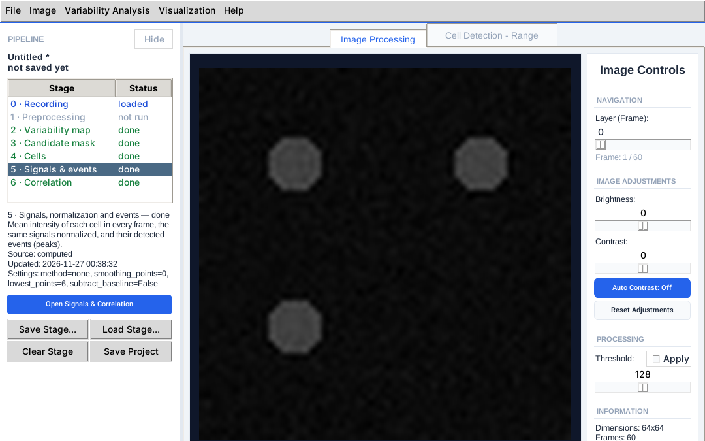

# User Manual — NecLab

Complete user manual for NecLab, the microscopy image analysis and data visualization tool developed at the LansBiodyt laboratory, Facultad de Ciencias, UNAM.

For installation instructions, see the [README](../README.md). This manual assumes the application is already installed and running (`python interface3.py`, or the precompiled executable).

> 🇲🇽 Versión en español: [MANUAL_USUARIO.md](MANUAL_USUARIO.md)

---

## Table of contents

1. [Application overview](#1-application-overview)
2. [Menu bar](#2-menu-bar)
3. [Tab: Image Processing](#3-tab-image-processing)
4. [Variability analysis and cell detection](#4-variability-analysis-and-cell-detection)
5. [Tab: Data Visualization](#5-tab-data-visualization)
6. [Tab: Multiple Files](#6-tab-multiple-files)
7. [Tab: Dendrogram](#7-tab-dendrogram)
8. [Tab: Time Series](#8-tab-time-series)
9. [Loading a precomputed correlation matrix](#9-loading-a-precomputed-correlation-matrix)
10. [Keyboard shortcuts](#10-keyboard-shortcuts)
11. [Automatic updates](#11-automatic-updates)
12. [Method glossary](#12-method-glossary)
13. [Troubleshooting](#13-troubleshooting)

---

## 1. Application overview

NecLab has two main workflows, organized as tabs inside a single window:

- **Image processing**: load an OME-TIFF stack, adjust its display, and analyze the temporal variability of each pixel to detect and segment cells as spatial clusters.
- **Data visualization and analysis**: load numeric series (a single `.npy`/`.csv` file, or several Excel files at once) to detect peaks, smooth signals, normalize, compute correlations, and build dendrograms.

Both workflows share the same main window, which has a menu bar at the top and a tabbed `Notebook` below it. Some tabs are present from startup (Image Processing, Data Visualization); others are created automatically the first time the corresponding feature is used (Multiple Files, Dendrogram, Time Series). The application's UI is entirely in English.

---

## 2. Menu bar

### File

| Item | Action |
|---|---|
| **New Project** / **Open Project...** / **Save Project** (`Ctrl+S`) / **Save Project As...** | Start, open or save a project: the whole analysis of one recording, every stage with its settings, saved in a `.neclab` folder. See [section 4.9](#49-projects). |
| **Show Pipeline Sidebar** | Shows or hides the pipeline sidebar on the left: each stage's status (not run, done, loaded, out of date, missing), its details, a button to open or run it, and saving or loading a single stage. See [section 4.10](#410-the-pipeline-sidebar). |
| **Open Recording (OME-TIFF / TIFF / NPY)...** (`Ctrl+O`) | Loads a recording (an image stack of frames × height × width) from an OME-TIFF, a plain TIFF or a NumPy `.npy` file, switches to the "Image Processing" tab, and enables the Image and Variability Analysis menus. Files that aren't a recording (e.g. a single 2D image) are rejected with an explanation. |
| **Open Pipeline Stage** | Starts the analysis at a later stage from a file saved earlier (or made by another program). See [section 4.8](#48-starting-from-a-saved-stage). |
| **Open Data (.npy / .csv / .xlsx)** | Loads a numeric data file into the "Data Visualization" tab. For CSV files, a dialog lets you pick the initial column (ROI); for `.npy` files, columns are auto-named "Column 1", "Column 2", etc. |
| **Load Correlation Matrix** | Loads an already-computed correlation matrix (CSV/XLSX, must be square) and displays it as a dendrogram + heatmap. See [section 9](#9-loading-a-precomputed-correlation-matrix). |
| **Open Multiple Files (.xls / .csv)** | Starts the "Multiple Files" workflow: pick several Excel files and the sheets to load from each. See [section 6](#6-tab-multiple-files). |
| **Exit** | Closes the application (asks for confirmation and closes every open plot window). |

### Image

Disabled until an OME-TIFF image is loaded.

| Item | Action |
|---|---|
| **Auto Contrast** | Turns display-only auto contrast on/off (a check mark shows when it's on). Each frame is rescaled only as it is shown; the analysis always uses the raw data. |
| **Histogram** | Shows a histogram of per-pixel variance across the whole stack, in a separate window. |
| **Binarize** | Opens a threshold dialog and binarizes the variance image. |
| **Restore Original** | Turns off every display adjustment (brightness, contrast, auto contrast, threshold) and shows the image exactly as loaded. |

> **Display vs. analysis:** brightness, contrast, auto contrast and the threshold preview only change what is shown on screen. They never modify the loaded data, so the variability analysis and the exported signals are always computed from the raw image.

### Variability Analysis

Disabled until an image is loaded. Populated dynamically with the 7 variability methods (see [section 4](#4-variability-analysis-and-cell-detection)). Each entry opens a full "Full Analysis — &lt;method&gt;" window for that method.

### Visualization

| Item | Action |
|---|---|
| **Dendrogram** | Disabled until data is loaded via `File → Open Data`. Once loaded, opens/activates the permanent "Dendrogram" tab (section 7). |
| **Time Series** | Disabled until data is loaded via `File → Open Data`. Once loaded, opens the "Time Series" tab (section 8). |

> **Note:** these two items only become active once data has been loaded with `File → Open Data (.npy / .csv)`. If you only used "Open Multiple Files (.xls)" or "Load Correlation Matrix", they stay disabled — use those tabs' own workflows for dendrograms and correlations instead.

### Help

| Item | Action |
|---|---|
| **Check for Updates** | Compares the local version against the latest commit on `main` on GitHub and offers to update the application's `.py` files. See [section 11](#11-automatic-updates). |
| **About NecLab** | Shows a dialog with the application name, repository, and contact email (sergio.cruz@ciencias.unam.mx). |

---

## 3. Tab: Image Processing

Visible from startup. Made up of an image panel (left) and a controls panel (right):

**NAVIGATION**
- **Frame**: slider to move through the frames/slices of the loaded stack. Shows "Frame: n / N".

**IMAGE ADJUSTMENTS**
- **Brightness** and **Contrast**: sliders from -100 to 100.
- **Auto Contrast: Off / On**: toggles display-only auto contrast (same as the Image menu item).
- **Reset Adjustments**: returns brightness/contrast to their defaults and turns auto contrast off.

**PROCESSING**
- **Threshold**: "Apply" checkbox to enable a binarization preview, plus a 0–255 threshold slider. The threshold applies to the displayed (8-bit) image; images with more than 8 bits are mapped to 0–255 from the stack's minimum to its maximum for display.

**INFORMATION**
- Read-only panel showing the dimensions, frame count, and data type of the loaded image.

### Typical workflow

1. `File → Open OME-TIFF` (or `Ctrl+O`) and select the file.
2. Scroll through frames with the "Frame" control to inspect the stack.
3. Adjust brightness/contrast, or turn on "Auto Contrast", to aid visual inspection (display only: the data used for analysis is not changed).
4. Optionally apply a threshold from the Image menu or the Processing panel.
5. Move to the **Variability Analysis** menu to start cell detection.

---

## 4. Variability analysis and cell detection

Choosing a method from the **Variability Analysis** menu opens a new 1400×800 window, "Full Analysis — &lt;method&gt;", with its own menu bar.

### 4.1 Available variability methods

| # | Method | Description | Default threshold |
|---|---|---|---|
| 1 | Range | Max − min per pixel over time | 100 |
| 2 | Population Variance | `np.var` with `ddof=0` | 120 |
| 3 | Sample Variance | `np.var` with `ddof=1` | 200 |
| 4 | Population Standard Deviation | `ddof=0` | 12 |
| 5 | Sample Standard Deviation | `ddof=1` | 5 |
| 6 | Coefficient of Variation | `std(ddof=1) / mean × 100` | 5 |
| 7 | Interquartile Range (IQR) | Q3 − Q1 | 20 |

### 4.2 Analysis window controls

- **Threshold**: binarization threshold for the variability image; starts at the chosen method's default (for a loaded map that isn't one of the 7 methods, at the map's 95th percentile). Not used while a loaded mask is in use.
- **Min Size** / **Max Size** (1–500 / 1–1000): minimum and maximum cluster size (in pixels) to keep.

### 4.3 Data menu

| Item | Action |
|---|---|
| **Attach Recording...** | Loads the recording that the map / mask / cells belong to (its frames must be the same size). Needed for the signals and the correlation analysis. If there is no variability map yet, it offers to compute one. |
| **Load Variability Map...** | Uses a saved map (stage 2) instead of the computed one. |
| **Load Mask...** | Uses a saved candidate-pixel mask (stage 3): the Clustering items then start from that mask instead of thresholding. |
| **Load Cells...** | Uses saved cells (stage 4): a label image saved with **Export → Save Cells**, ImageJ ROIs (`.roi`, or the `RoiSet.zip` saved by the ROI Manager; cell *n* is the *n*-th ROI), or a coordinates `.txt` file from older versions. ROI and `.txt` files need the image size, so attach the recording or load a map first. |
| **Stop Using Loaded Mask** | Goes back to thresholding the variability map. |

Every file is checked when it is loaded (size, contents, and that it matches what is already loaded); a file that can't be used is rejected with a message explaining why.

### 4.4 Clustering menu

| Item | Action |
|---|---|
| **Process Cluster (Basic)** | Binarizes the sharpened variability image with the threshold, finds connected regions, and keeps those between Min Size and Max Size. |
| **Process Cluster (Advanced)** | Same as basic, but regions larger than Max Size are split around the local maxima (peaks) of the variability image instead of being discarded. |
| **Decompose Large Clusters (KMeans)** | Same as basic, but regions larger than Max Size are split with KMeans (position + variability); parts smaller than Min Size are discarded. |

Each item runs a complete detection with the current Threshold / Min Size / Max Size (or from the loaded mask) and replaces the previous cells (and clears the selection). Advanced and KMeans need a variability map.

**Cell IDs:** every detected cell gets a permanent ID (1, 2, 3, ... in reading order of each cell's top-left pixel: top to bottom, then left to right). The same settings on the same image always give the same IDs, and these IDs are used everywhere: the plot labels, the selection list, the exported signals (`cell_<id>` columns) and the saved cells.

### 4.5 Selecting clusters

- Click cells in the plot to select them (they highlight in red, with their ID).
- **Region Selection**: hold the right mouse button and drag over the plot to add/remove several clusters at once inside a rectangle; use the Add/Remove toggle to pick the mode.
- **Selection** menu: `Select All`, `Clear Selection`.
- The list of selected clusters appears in the side panel, each with a "Remove" button.

### 4.6 3D visualization

**Visualization → 3D View** menu: opens a 3D surface (matplotlib) of the variability image, which can be rotated with the mouse.

### 4.7 Export

**Export** menu:
- **Save Image**: exports the current analysis image.
- **Save Variability Map...**: saves the map (stage 2) as `.npz` (keeps the method name), `.npy` or 32-bit `.tif`.
- **Save Mask...**: saves the candidate-pixel mask of the last detection (stage 3) as `.tif` (0/255) or `.npy`.
- **Save Signals (CSV / XLSX / NPY)...**: exports the signal of each selected cell (the mean of its pixels in every frame), in the NecLab signals format:
  - `.csv` / `.xlsx`: a header row `frame, cell_<id>, cell_<id>, ...` and one row per frame.
  - `.npy`: a `(frames, 1 + cells)` array whose first column is the frame number (0, 1, 2, ...), followed by the cells in ID order. A `.npy` can't store the cell IDs; use `.csv`/`.xlsx` to keep them.

  These files can be opened directly with `File → Open Data Files`: the frame column is recognised and not shown as a data column.
- **Save Cells (Label Image)...**: saves the cells as a label image (`.tif` or `.npy`: an image the size of one frame where each pixel holds the ID of its cell, 0 = background) plus a table with the same name and a `.csv` extension (`cell_id, n_pixels, centroid_row, centroid_col`). If cells are selected, it asks whether to save only those. Load it back later with **Data → Load Cells...**.
- **Use Selected (Correlations)**: opens the "Correlation Analysis — Selected Cells" window, with buttons to compute Pearson, Kendall, or Spearman correlation across the chosen cells' signals, and **Export Time Series** (the raw signals, same format as Save Signals), **Export Normalized** (the signals as shown, stage 6), **Export Correlation** (the current matrix, which can be reopened as stage 7), **Export Cells** (saves the selected cells as a label image) and **Generate Report**.
  - **Normalization**, **Lowest points**, **Smoothing**, **Show lowest points** + **Apply**: how the signals are normalized before the correlation is computed (see [section 12](#normalization-methods-correlation-analysis-window)). The default is *None*, the raw mean intensities. The plot, the correlation and the dendrogram all use the normalized signals, which are recorded as stage 6 of the project (and the settings are restored when the project is reopened).
    - **Lowest points** (2–50, default 6): how many of each signal's genuine lowest points build its baseline, a line through them. Used by *Divide by lowest-points baseline*, *Subtract lowest-points baseline* and *Smoothing*.
    - **Divide by lowest-points baseline**: each signal divided by that baseline, so its lowest points lie on a horizontal line at 1 and every value reads as "times the baseline" (the Convex Envelope normalization of earlier NecLab versions). If a signal's baseline reaches zero or below (e.g. data already normalized to 0–1), dividing would blow up: NecLab says which cell and shows the raw signals instead.
    - **Subtract lowest-points baseline**: the same baseline is subtracted instead of divided, so the lowest points lie on a horizontal line at 0 and every value reads as "above the baseline", in the signal's own units. With no division, it works for any signal, including ones near or below zero.
    - **Smoothing**: subtracts that baseline and adds the signal's lowest level back (the lowest points end up on a horizontal line at that level instead of 0). Not applied on top of the two lowest-points normalizations, which already remove the same baseline.
    - **Show lowest points**: marks the points used on the signals plot.
  - The dendrogram uses Ward linkage on the distance 1 − |r|, like every other dendrogram in NecLab.

Signals and the correlation analysis need the recording; without it they say so and point to **Data → Attach Recording...**.

### 4.8 Starting from a saved stage

The analysis is a chain of stages, and each one can be started from a file instead of being recomputed: save a stage's result once, and later (or on another computer) open it and continue from there. **File → Open Pipeline Stage** lists the stages that can be opened:

| Stage | What it holds | Files | Opens in |
|---|---|---|---|
| 0 · Recording | The image stack | `.ome.tif`, `.tif`, `.npy` (`File → Open Recording`) | Image Processing tab |
| 2 · Variability Map | Per-pixel variability | `.npz` (one or more named maps), `.npy`, `.tif` | Analysis window |
| 3 · Candidate Mask | Pixels that may belong to cells | `.tif`/`.npy` with only two values (0/1 or 0/255) | Analysis window |
| 4 · Cells | Label image (permanent IDs) | `.tif`/`.npy` label image, ImageJ `.roi`/`.zip`, older `.txt` | Analysis window |
| 5–6 · Signals | One column per cell, one row per frame | `.csv`, `.xlsx`, `.npy` | Multiple Files tab |
| 7 · Correlation Matrix | Square matrix | `.csv`, `.xlsx` | Correlation view (section 9) |

- If a recording is open and the file's images are the same size, the recording is attached automatically. If the sizes differ, you are asked whether to continue without it.
- Whatever is missing switches off only the features that need it: e.g. starting from a mask without a recording, Basic detection works, Advanced/KMeans ask for a variability map, and signals ask for the recording.
- Signals tables from other programs are accepted: a header row is optional, and a first column named `frame`/`time`/`time_s` or holding 0, 1, 2, … is treated as time rather than as a cell. Sheets with fewer than 2 rows or no numbers are rejected with the reason.

### 4.9 Projects

A **project** keeps the whole analysis of one recording: the recording itself (referenced, not copied), and every stage you computed or loaded, with the settings used. Everything you do is recorded in the current project automatically: opening a recording, computing or loading a map or a mask, detecting or loading cells, selecting cells, extracting their signals and computing a correlation. The window title shows the project's name, with a `*` when there are unsaved changes.

- **File → Save Project** (`Ctrl+S`) saves it as a folder named `<name>.neclab`; **Save Project As...** saves a copy under another name. NecLab asks to save unsaved changes before closing, starting a new project or opening another one.
- **File → Open Project...** (choose the `.neclab` folder) restores the recording in the Image Processing tab and the cell detection window with the cells, the selection, the threshold and the sizes used.
- **The recording isn't copied** into the project. The project remembers where it is (also relative to the project folder, so moving both together keeps working) and a quick checksum of it. If it can't be found, NecLab offers to locate it; the other stages open anyway. If the file has changed, the stages computed from it are marked out of date.

Contents of a project folder (only the stages that have data):

| Folder | Files |
|---|---|
| `manifest.json` | List of stages, their status and settings |
| `s0_raw/` | `stage.json`: where the recording is, its size and checksum |
| `s2_features/` | `maps.npz` |
| `s3_mask/` | `mask.tif` |
| `s4_cells/` | `cells.tif` (label image) + `cells.csv` (cell table) |
| `s5_signals/` | `signals_raw.csv` |
| `s6_analysis/` | `signals_norm.csv`, `events.csv` |
| `s7_correlation/` | `correlation.csv` |

The files are the same formats as the Export menu, so they can be opened in Excel, ImageJ or Python, or with **File → Open Pipeline Stage**.

> The Multiple Files tab (comparing several recordings' signals) isn't part of a project; its files are opened and saved from that tab as before.

### 4.10 The pipeline sidebar

The panel on the left of the main window shows the current project and its 8 stages, and is the quickest way to move through the analysis. Hide it with its **Hide** button and show it again with **File → Show Pipeline Sidebar**; drag its right edge to resize it.

The top shows the project's name (`*` = unsaved changes) and where it is saved. Each stage's status is shown in color:

| Status | Meaning |
|---|---|
| not run | No data for this stage yet |
| done | Computed in NecLab and up to date |
| loaded | Loaded from a file and up to date |
| out of date | Something it was computed from has changed since (e.g. you detected cells again after extracting signals, or opened a different recording): recompute it |
| missing | Its data couldn't be loaded (e.g. the recording wasn't found); the reason is shown in the details |

Click a stage to see its details: what it holds, where it came from, when it was updated, the settings used, and, for a stage not run yet, what it needs. The blue button below does the next sensible thing for that stage (double-clicking the stage does the same):

| Stage | Button |
|---|---|
| 0 · Recording | **Open Recording...**, **Show Recording** (Image Processing tab), or **Locate Recording...** when it is missing |
| 1 · Preprocessing | Not available yet |
| 2 · Variability map | **Compute Variability Map...** (asks which measure) when there's a recording; otherwise **Open Variability Map...** |
| 2–4 (with data) | **Open / Show Cell Detection Window** |
| 3 · Candidate mask, 4 · Cells | **Open Candidate Mask... / Open Cells...** when there's nothing yet |
| 5–7 with cells and the recording | **Open Signals & Correlation**: the correlation analysis of the selected cells (asks to use all cells if none are selected) |
| 5–6 with data only | **View in Multiple Files** (stage 6 opens with Normalization = None) |
| 7 with data only | **View Correlation Matrix** (matrix + dendrogram) |
| 5–7 with nothing yet | **Open Signals Files... / Open Correlation Matrix...** |

The buttons underneath:
- **Save Stage...** saves just that stage to a new folder (its files plus a `stage.json` with its settings).
- **Load Stage...** loads a stage saved that way, or one stage from another project folder, into the current project. It is checked against what is loaded (e.g. the cells must be the same size as the recording) and replaces that stage.
- **Clear Stage** removes the stage from the project.
- **Save Project** is the same as File → Save Project.

---

## 5. Tab: Data Visualization

Visible from startup, but only fully active once data is loaded via `File → Open Data (.npy / .csv)`.

### 5.1 Tab's local menu

A dedicated menu bar sits at the top of the tab:

- **View**
  - `Smoothing`: toggles convex-envelope smoothing on the signal.
  - `Show points`: shows/hides the signal's data points.
  - `Show Labels (Correlation)`: shows/hides axis labels on the correlation heatmap.
- **Save**
  - `Save Data Image...`: saves the data plot as an image.
  - `Save Correlation...`: saves the correlation heatmap as an image.
  - `Save Correlation Data...`: exports the correlation matrix (CSV/XLSX).
  - `Save Peaks CSV...`: exports the detected peaks (see 5.4).

### 5.2 Side panel

- **DATA COLUMNS**: multi-select list of every column in the loaded file.
- **PEAK FINDER**: combo box with the 7 peak-detection methods (see the [glossary](#12-method-glossary)) and a "Points:" spinbox (2–50) for the number of points used by the convex-envelope smoothing.
- **CORRELATION**: combo box to choose the method (`pearson`, `kendall`, `spearman`).
- **SELECTION**: single-select list, with "Add to Selection" / "Remove from Selection" buttons. At least 2 columns must be in the selection to draw the correlation heatmap.

### 5.3 Plot area

Clicking a column builds three stacked panels:

1. **Top**: the raw signal for the chosen column, with peak markers (if a detection method is active) and the smoothing baseline (if "Smoothing" is on).
2. **Middle**: the "processed" view — either the smoothed signal alone, or the diagnostic plot of the selected peak-detection method.
3. **Bottom**: the correlation heatmap (Pearson/Kendall/Spearman) for the columns in the Selection list.

### 5.4 Exporting detected peaks

`Save → Save Peaks CSV...` runs the active peak-detection method over every column in the Selection list and writes a CSV with a `TIME` column plus one 0/1 flag column per selected data column (1 = a peak was detected at that time index). Requires having already run a detection method once, and at least one column in the Selection list.

---

## 6. Tab: Multiple Files

Created the first time you use `File → Open Multiple Files (.xls)`. Lets you load and compare several sheets from one or more Excel files at once.

### 6.1 Loading files

1. `File → Open Multiple Files (.xls)`.
2. Select one or more Excel files in the dialog.
3. For each file, a "Select Sheets to Load" dialog appears with a checkbox per sheet (plus "Select All"/"Deselect All").
4. Sheets are read **without a header row** (columns are identified only by position: Column 1, Column 2, ...). Only columns present in **every** loaded sheet are shown.
5. Loading runs in a background thread with a progress window; wait for it to close before interacting with the tab.

### 6.2 Tab's local menu

- **Processing**
  - `Show Data Names` (default off): shows/hides per-sheet x-axis labels on both plots.
  - `Smoothing` (default **on**): applies convex-envelope smoothing to both the line plot and the heatmap.
  - `Smoothing Points...`: opens a dialog with a spinbox (2–50, default 2) for the smoothing point count.
  - `Shared Color Scale (heatmap)` (default off): uses one shared color scale across every sheet instead of auto-scaling each sheet independently.
  - **Normalization** (choose one):
    | Mode | Description |
    |---|---|
    | By Column (minimum of that column in each sheet) | divides by that column's own minimum, per sheet (default) |
    | By Sheet (minimum of the entire sheet) | divides by the minimum across the whole sheet |
    | By Column Across All Sheets (shared minimum) | divides by that column's minimum pooled across every loaded sheet |
    | Global (minimum of all columns and sheets) | divides by the minimum of the entire loaded dataset |
    | None (data already normalized) | values used as loaded, e.g. for signals saved with **Export Normalized** (stage 6) |

    A column (or sheet) whose minimum is 0 isn't divided, instead of producing infinite values. The line plot, the heatmap and `Save Smoothed Data` all use the same normalization code as the rest of NecLab.
- **Visualization**
  - `Axis Limits (Top Plot)...`: manually sets X/Y limits for the line plot ("Auto" button to revert).
  - `Color Limits (Heatmap)...`: manually sets the heatmap's color range, showing the range currently in use ("Auto" button to revert).
  - `Show Labels (Correlation)`: shows/hides axis labels on the correlation heatmap.
  - `Save Plot Image...`: saves the line plot (PNG/PDF/TIFF/SVG/EPS).
  - `Save Heatmap Image...`: saves the heatmap.
  - `Save Smoothed Data (XLSX/CSV)...`: exports **every** common column from **every** loaded sheet, processed exactly as shown on screen (interpolated, normalized per the active mode, smoothed if enabled), into a single file, each source sheet's block separated by 20 blank rows. Runs in a background thread with a progress window.
- **Save Data**
  - `Edit Classifications...`: add, rename, or delete classification labels used to tag each loaded sheet; changes propagate to every column.
  - `Save Classifications...` / `Load Classifications...`: persist/restore, per data column, which classification label is assigned to each sheet (XLSX/CSV).

### 6.3 Tab layout

- Left panel: "DATA (COLUMNS)" list of the available common columns.
- Draggable horizontal split between the left panel and the plot area (enforced minimum width).
- Draggable vertical split between:
  - **Top panel**: combined line plot — the chosen column, plotted for every loaded sheet, offset horizontally with dashed separators between sheets; classification combo boxes aligned above each sheet's segment; a "▶" button to advance to the next column.
  - **Bottom panel**: one heatmap tile per sheet (columns = data columns, rows = samples).

Both panels redraw to fill their space on window resize or when a split is released.

---

## 7. Tab: Dendrogram

Created the first time data is loaded (via `File → Open Data`) and `Visualization → Dendrogram` is used.

- Side panel: "DATA COLUMNS" list (same as Data Visualization), "SELECTION" list, "Add to Selection"/"Remove from Selection" buttons, and "Save Dendrogram Image" / "Save Dendrogram CSV" buttons.
- Plot area: top panel shows the signal of the chosen column; bottom panel shows the dendrogram of the columns in the Selection list (minimum 2). The dendrogram clusters the **correlation** between the selected signals (correlation type from the Multiple Files tab), with the clustering shared by every view: Ward linkage on the distance 1 − |r| (see [section 12](#correlation-methods)).
- "Save Dendrogram CSV" exports the signals (`Sample_Index, Signal, Dendrogram_Position`) and the linkage matrix (`Merge_Step, Child_1, Child_2, Distance, Size`; children below the number of signals are signals, the rest are earlier merges).

---

## 8. Tab: Time Series

Created via `Visualization → Time Series` (requires data loaded through `File → Open Data`).

- Its own data-column list and selection list.
- "Show Labels" checkbox.
- A single-signal preview (top) and a multi-signal overlay with a per-signal vertical offset (bottom), for visually comparing several columns at once.
- Buttons: "Save Image", "Save CSV", "Close Tab".

---

## 9. Loading a precomputed correlation matrix

`File → Load Correlation Matrix` loads a correlation matrix computed externally (CSV or XLSX). It must be a square matrix; a warning is shown if any value falls outside the [-1, 1] range.

It is rendered directly inside the "Data Visualization" tab's main plot area as a dendrogram (top) plus a correlation heatmap (bottom), with its own buttons: "Save Dendrogram", "Save Correlation Matrix" (CSV), "Save Correlation Matrix Image", "Save All". The dendrogram uses the same clustering as every other view (Ward linkage on 1 − |r|).

---

## 10. Keyboard shortcuts

| Shortcut | Action |
|---|---|
| `Ctrl+O` | Open OME-TIFF |

There is no drag-and-drop support; all file loading goes through the operating system's file dialogs.

---

## 11. Automatic updates

`Help → Check for Updates`:

1. Queries, in a background thread, the latest commit on the `main` branch of the `sergiocruzunamia/neclabunam` GitHub repository, and compares it against the locally recorded version.
2. If a newer version is found, offers to download the current versions of the 8 core `.py` files (`interface3.py`, `peak_functions.py`, `visualization_helpers.py`, `corr_dendo_functions.py`, `variability_functions.py`, `image_loader.py`, `image_processing.py`, `multi_xls_helpers.py`) and overwrite them locally.
3. Offers to restart the application automatically afterward.

Requires an internet connection. This feature does **not** update Python dependencies or the packaged executable itself — only the `.py` source files — so it only applies to installations run from source (installation option B/C), not to precompiled executables.

---

## 12. Method glossary

### Peak detection (Peak Finder)

| Method | Technique | Parameters (default) |
|---|---|---|
| Elliptic Envelope | `sklearn.covariance.EllipticEnvelope` with `ElasticNet` detrending | Contamination (0.01) |
| Peak Caller | Custom rise/fall percentage heuristic | Rise % (5), Fall % (5), Max Lookback (10 pts), Max Lookahead (10 pts) |
| Local Outlier Factor | `sklearn.neighbors.LocalOutlierFactor` | N Neighbors (20) |
| Peak Function 4 | Elliptic Envelope + SVR | Contamination (0.01) |
| Isolation Forest | `sklearn.ensemble.IsolationForest` | Contamination (0.05) |
| Linear Model | `SGDOneClassSVM` | Nu (0.131) |
| Peak Function 7 | Lasso + Local Outlier Factor | N Neighbors (20) |

Smoothing (independent of the peak method) uses a convex envelope: it builds a piecewise-linear baseline from the signal's genuine local-convexity "lowest points" (the "Points" parameter, 2–50) and subtracts it from the raw signal. Used in both Data Visualization and Multiple Files.

### Variability methods

See the table in [section 4.1](#41-available-variability-methods).

### Correlation methods

`pearson` (linear), `kendall` (rank-based, tau), `spearman` (rank-based, rho) — available in Multiple Files (and its Dendrogram tab) and in the cell detection window's correlation analysis.

**Clustering (dendrograms).** Every dendrogram in NecLab (correlation analysis window, Dendrogram tab, loaded correlation matrix) clusters the signals the same way: the distance between two signals is 1 − |r| (0 when they are perfectly correlated *or* anti-correlated, 1 when unrelated), and clusters are merged with Ward linkage. Note that anti-correlated signals are therefore grouped together.

### Normalization methods (correlation analysis window)

| Method | What it does |
|---|---|
| None (raw values) | Mean intensity of each cell, as extracted |
| Divide by minimum | Each signal divided by its own minimum |
| ΔF/F0 | (F − F0) / F0, with F0 = the signal's 10th percentile |
| Detrend + scale to 0–1 | Removes a linear trend (ElasticNet), then scales to 0–1 |
| Divide by lowest-points baseline | Divides by the line through the signal's genuine lowest points, so they lie on a horizontal line at 1 |
| Subtract lowest-points baseline | Subtracts that line instead, so the lowest points lie on a horizontal line at 0 (no division) |

Each can be combined with convex-envelope smoothing (see Peak detection above). The Multiple Files tab's divide-by-minimum modes use the same code.

---

## 13. Troubleshooting

See the "Troubleshooting" section of the [README](../README.md#troubleshooting) for installation and startup errors.

**Usage-specific issues:**

- **"Save Peaks CSV..." is disabled**: run a peak-detection method on a column first, and add at least one column to the Selection list.
- **The correlation heatmap doesn't appear**: you need at least 2 columns in the Selection list.
- **"Load Correlation Matrix" rejects my file**: the matrix must be square (same number of rows and columns, with matching headers).
- **Some columns from my sheets don't show up in Multiple Files**: only columns present in **every** loaded sheet are shown (matched by position, since sheets are read without headers). If one sheet has fewer columns than the others, the "extra" columns from the other sheets won't be displayed.
- **Visualization → Dendrogram / Time Series are disabled**: they only activate after loading data via `File → Open Data (.npy / .csv)`; they are not enabled by "Open Multiple Files (.xls)" or "Load Correlation Matrix".

If the problem persists, contact sergio.cruz@ciencias.unam.mx or open an issue on the GitHub repository.
